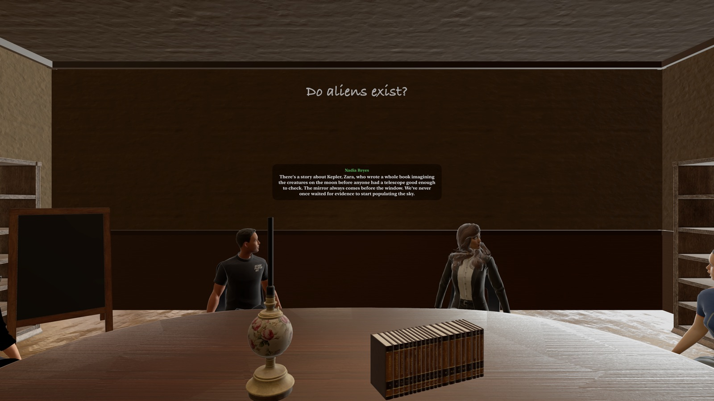
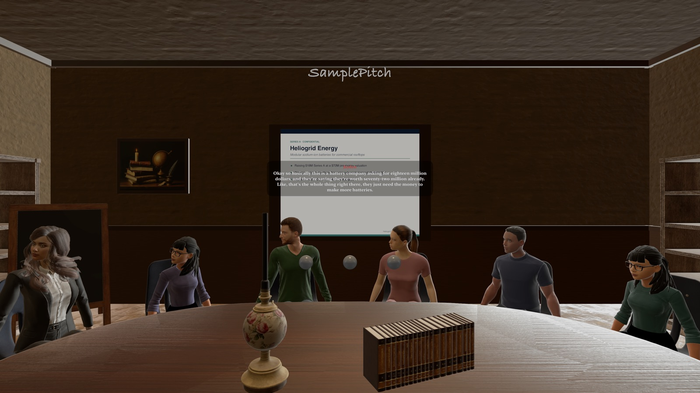
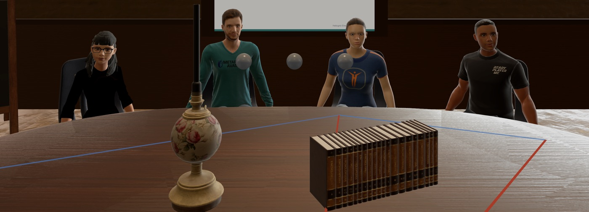
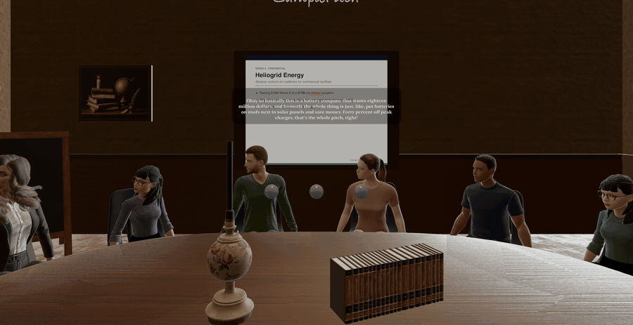

# Roundtable / HarknessAI

**A native Apple Vision Pro app that seats you at a Harkness table with AI characters who talk, look at each other, look at you, and let you interrupt them with your voice.**

Two experiences share one codebase:

- **Roundtable** – an evening seminar in an antique classroom. Pick a topic (or drop in a PDF), seat three to five characters, and debate. A single "director" LLM writes every turn; Deepgram voices and blend-shape lip sync bring the cast to life; a gaze proxy means they notice where you're looking, and a live mic means you can cut in whenever you want.
- **HarknessAI** – the same engine turned into a *flight simulator for teachers*. You are the teacher. Eight simulated students with deliberately flawed archetypes (the Monopolizer, the Ghost, the Confidently Incorrect…) work through a reading, and the app scores every move you make: did you hold the silence, redirect the deflection, keep your talk share under 15 percent?

**Web:** [harknessai.com](https://harknessai.com) (HarknessAI landing page, screenshots, captures from the headset, and a playable three-minute browser version of the tutorial at [harknessai.com/play](https://harknessai.com/play)) · [roundtable.spmhresearch.org](https://roundtable.spmhresearch.org) (Roundtable splash, the browser table at `/table`, and the character creator at `/characters`).

<p align="center">
  
  
</p>
<p align="center">
  
  
  
</p>

---

## Contents

1. [What it feels like](#what-it-feels-like)
2. [Requirements](#requirements)
3. [Setup and first run](#setup-and-first-run)
4. [Architecture](#architecture)
5. [The conversation engine](#the-conversation-engine)
6. [Voice, lip sync and gaze](#voice-lip-sync-and-gaze)
7. [The scene](#the-scene)
8. [HarknessAI teacher training](#harknessai-teacher-training)
9. [SharePlay and the iPhone companion](#shareplay-and-the-iphone-companion)
10. [Debug launch arguments](#debug-launch-arguments)
11. [Asset pipeline](#asset-pipeline)
12. [Web companion](#web-companion)
13. [Repository layout](#repository-layout)
14. [Known limitations](#known-limitations)

---

## What it feels like

You open the app in a floating window: a deck of topic cards ("Do aliens exist?", "Is free will an illusion?", "Should we colonize Mars?", or your own), a volumetric cast table where you drag tarot-style character cards into seats, and a settings panel. Tap **Enter the Roundtable** and the room fills in around you: herringbone parquet, plaster walls hung with framed paintings, a chalkboard, bookshelves, an oil lamp, and a long oval Harkness table whose near edge is already in front of you.

The moderator welcomes the table and frames the question. Characters answer each other, disagree, quote poets and statistics, and turn their heads to whoever is speaking. A green gem hovers above the current speaker. When someone makes a point worth keeping, it crystallizes into an **insight** you collect for the recap. Look at a character for a moment and the director notices. Say something out loud and the speaker ducks, then stops, and the most fitting character answers *you*.

Drop in a PDF instead of a topic and the deck appears on a presentation board; the cast has read it, discusses the page you're on, and reacts when you turn pages.

In HarknessAI mode the roles flip. The students carry the discussion and you have only questions, redirects and silence. Post-it crib notes on the table in front of you name the realizations the class should reach on its own; look at one and a coaching panel unfolds with two or three Socratic moves. When the room goes quiet a tension bar fills. Rescue them and you lose points. Hold the silence and a student takes ownership.

## Requirements

| | |
|---|---|
| Hardware | Apple Vision Pro (visionOS 26) for the real thing. The visionOS simulator runs the full loop, including voice, with caveats noted below. |
| Tooling | Xcode 26 with the visionOS 26 SDK. Swift 5 mode, default actor isolation `MainActor`, approachable concurrency on. |
| Accounts | [OpenRouter](https://openrouter.ai) (LLM), [Deepgram](https://deepgram.com) (TTS + STT), optional [Exa](https://exa.ai) (fresh web facts). |
| Companion | iPhone target needs iOS 26 and is only useful for SharePlay sessions. |

## Setup and first run

1. **Clone** the repo and open `roundtable/roundtable.xcodeproj`.
2. **Create `Secrets.plist`** in **both** `roundtable/roundtable/` and `roundtable/Shared/` (both paths are gitignored; the visionOS and iOS targets each bundle their own copy). A plain string dictionary:

   ```xml
   <?xml version="1.0" encoding="UTF-8"?>
   <!DOCTYPE plist PUBLIC "-//Apple//DTD PLIST 1.0//EN" "http://www.apple.com/DTDs/PropertyList-1.0.dtd">
   <plist version="1.0">
   <dict>
     <key>OPENROUTER_API_KEY</key> <string>…</string>
     <key>DEEPGRAM_API_KEY</key>   <string>…</string>
     <key>EXA_API_KEY</key>        <string>…</string>
   </dict>
   </plist>
   ```

   `Secrets.swift` reads these at launch and asserts if the file is missing. A shipped build would proxy these calls through a server instead; this layout is for personal development builds.

3. **Signing.** Both app targets use the `com.apple.developer.group-session` entitlement for SharePlay. Set your own team and bundle identifier.
4. **Run** the `roundtable` scheme on a Vision Pro or the simulator. The first launch of a session downloads nothing; all 3D assets are bundled in `RealityKitContent`.
5. **Simulator tips.** Terminate the old process before reinstalling (`xcrun simctl terminate booted <bundle id>`), otherwise the previous build keeps running. Screenshots: `xcrun simctl io booted screenshot out.png`. After any *failed* build, do a clean build: Xcode has linked a stale object file more than once and reported success with old code.

## Architecture

```
roundtableApp ─ AppModel (phase: menu → loading → immersive → recap)
      │
      ├─ MenuView ─ TopicDeck · CastTableVolume (volumetric card table) · settings
      │
      ├─ ImmersiveView ─ RoundtableScene (room, table, props, seat anchors)
      │        │         LightingRig · SpeakingGem · SubtitleView · HarknessOverlay
      │        │
      │        └─ SessionController          owns everything alive in a session
      │               ├─ ConversationDirector   the one LLM that writes every turn
      │               ├─ PlaybackController     2-turn lookahead, spatial audio, gaze choreography
      │               │      ├─ TurnSynthesizer / DeepgramTTSClient
      │               │      ├─ LipSyncDriver + VisemeMapper
      │               │      └─ CharacterEntity (AvatarLoader, SkeletalPoses, blend shapes)
      │               ├─ GazeTracker            head-direction proxy for "who am I looking at"
      │               ├─ SpeechInput            always-on Deepgram streaming STT
      │               └─ GroupSessionCoordinator (SharePlay; silent no-op when solo)
      │
      └─ RecapView ─ insights, transcript, Harkness debrief
```

Everything in `roundtable/Shared/` compiles into both the visionOS app and the iPhone companion: turn models, seating geometry, the TTS client, speech input, SharePlay plumbing and the wire messages.

Key decisions, and why:

- **Native RealityKit, not Unity/PolySpatial.** Full control over attachments, spatial audio, skeletal poses and SharePlay, with no middleware licence.
- **One director LLM, strict JSON.** A single model sees the whole transcript and emits one `DirectorTurn` per request (speaker, text, emotion, look target, gesture, optional insight, invites-user flag). Characters are prompts, not agents; that is what keeps turns coherent and lets the director choreograph who looks at whom.
- **Epoch-based interruption.** Every in-flight request, synthesized clip and queued turn carries the epoch it was created in. When the user speaks the epoch increments and everything stale throws itself away. Interruption costs nothing and never races.
- **OpenRouter for every model call** (`OpenAIClient.swift`, chat-completions API with `json_schema` response format). Director turns run on `anthropic/claude-fable-5.1` with low reasoning effort (about six seconds, hidden by the lookahead buffer); interjection replies, summaries, node suggestions and teacher-move classification use `anthropic/claude-sonnet-5` with reasoning off for latency.
- **Deepgram for both directions.** Aura-2 voices per character; nova-3 / Flux streaming STT for the user.

## The conversation engine

**`ConversationDirector`** owns the transcript and the epoch. It builds the system prompt from the cast's personality sheets (`CharacterRoster`), the topic or document summary, an optional fresh-facts block from Exa, the current PDF page, and a per-request *directive* ("open the seminar", "continue naturally", "the user just spoke; the most fitting character responds, addressing them as you", a stall, a steering nudge…).

**`PlaybackController`** keeps a two-turn lookahead: while one turn plays, the next is already written and its audio is synthesizing. It places each clip on the speaker's entity for spatial audio, drives lip sync, moves the gem, aims every head (speaker at `look_target`, everyone else at the speaker with staggered delays), and fires gestures. Turns are chunked at clause and sentence boundaries by `TurnSynthesizer` so the first audio plays about a second after the text arrives.

**Interruption flow.** `SpeechInput` streams echo-cancelled mic audio to Deepgram. On the VAD's speech-start event the current speaker ducks instantly; if the user keeps talking the clip hard-pauses; on the final transcript the director gets an interjection directive and answers on the fast model. If the user stops without a transcript, playback simply resumes. A token-overlap echo guard discards transcripts that are really the characters' own voices (relevant in the simulator, where the Mac mic hears the speakers).

**Insights.** When the director labels a turn with a three-to-six-word gem, it is collected with the speaker's name and whether the user's interjection sparked it; the recap shows them all.

**Documents.** `DiscussionDocument` wraps a PDFKit document, extracts per-page text, asks the fast model for a summary, and tracks the page on the presentation board. Turning a page injects a transcript note so the cast reacts.

## Voice, lip sync and gaze

- **TTS.** `DeepgramTTSClient` returns MP3 for a text chunk and voice model. Each character has a fixed Aura-2 voice (Hera for the moderator, Arcas, Aurora, Orion, Luna for the seminar cast; Draco, Pandora, Theia, Zeus, Luna, Arcas, Aurora, Hyperion for the eight students). Deepgram synthesizes at roughly two times real time, hence chunking and concurrency limits: more than about fifteen simultaneous requests returns 429s that drop audio silently, so pre-synthesis is staggered and retried.
- **Lip sync.** Deepgram gives no phoneme timestamps, so `VisemeMapper` estimates a viseme track from the text: each grapheme gets a duration weight, the track is scaled to the measured clip length, and adjacent identical visemes merge. `LipSyncDriver` applies exponential attack/release smoothing with co-articulation (the next viseme ramps in during the tail of the current one) and writes blend-shape weights every frame. Avatars carry Oculus-style viseme blend shapes (`viseme_aa`, `viseme_oh`, …) plus `jawOpen`.
- **Gaze.** visionOS gives apps no raw eye data, so `GazeTracker` polls the device anchor and classifies which seat the head is facing (about a 15° half-angle cone; post-it focus uses a tighter 9° cone with a short dwell). Characters aim head and eye bones at the headset for eye contact; in HarknessAI a gaze on a post-it opens its coaching panel.
- **Seating.** `SeatingLayout` puts the origin at the user's feet with the table centre straight ahead on the far side of an oval, so the user is already at the table when the space opens. Seats are indexed around the ellipse; the moderator takes the head.

## The scene

`RoundtableScene` builds the antique classroom and degrades gracefully: every asset that fails to load becomes a grey-box primitive rather than an empty room.

- **Room shell** with Poly Haven PBR textures (clay plaster walls, herringbone parquet, mocha oak veneer).
- **Harkness table** generated with Meshy text-to-3D (procedural oval fallback).
- **Props** from Poly Haven: school chairs, standing chalkboard, worn bookshelf, encyclopedia set, vintage oil lamp.
- **Wall art**: six FAL-generated framed paintings and a Persian rug.
- **Lighting**: `LightingRig` provides a procedurally generated warm-interior image-based light plus two spotlights. In full immersion the app supplies every photon; without an IBL, PBR materials render black.
- **Characters** are converted USDZ rigs (see [Asset pipeline](#asset-pipeline)). They sit via procedural skeletal poses written with `SkeletalPosesComponent` (the rest frame is Z-up). Clothing is recoloured per character through the mesh's material models, flat matte and never emissive.
- **Attachments**: subtitles under the active speaker, the speaking gem, the Harkness overlay, and (SharePlay) easel cards for iPhone guests.

## HarknessAI teacher training

`SessionMode.harkness(HarknessSetup)` turns the engine into a trainer. From the menu's HarknessAI card you supply a reading (PDF) and three to five **realization nodes**, the ideas the class should arrive at on its own; **Suggest nodes** drafts them from the document.

**The class.** `HarknessStudents` defines eight students with archetypes that are the obstacles you practise against:

| Student | Archetype | Habit |
|---|---|---|
| Jayden | The Monopolizer | first to speak, surface level, fills every silence |
| Sofia | The Tangent Weaver | derails into details and anecdotes |
| Wren | The Ghost | brilliant, silent unless safely invited |
| Tyler | The Confidently Incorrect | bold wrong claims delivered with certainty |
| Maddie | The Echo | restates the previous speaker |
| Amir, June, Leo | The Builder, The Challenger, Solid | the earnest baseline |

**Mechanics** (`SessionController` + `HarknessModels`):

- **Director extensions.** In this mode `DirectorTurn` also carries `stall_after`, `deflection`, `covered_node`, `closest_node` / `node_closeness` and a `coach_hint`.
- **Silence tension meter.** A stall fills a ten-second bar. Speaking before it fills is a *rescue* (−20); holding it (+40) hands ownership to a student.
- **Deflections.** A student turns to you ("is that right?"). Your reply is classified in parallel by the fast model into a `TeacherMove` (textual tether, spotlight, open question, redirect, lecture…). Redirecting passes (+30); giving the answer is the *lecturing penalty* (−40). Tethers and spotlights earn +10 and flash on the HUD.
- **Realization nodes.** When the class reaches a node on its own, +100, the Guideflow orb above the table turns gold and the crib note goes green. Closeness pulses the note amber and whispers a coach hint.
- **Post-it crib notes.** Yellow 15 cm notes in an arc in front of you carry LLM-condensed labels; gazing at one swells it and unfolds a coaching panel with two or three Socratic moves for that node.
- **Conversation web.** Chords on the tabletop between consecutive speakers: blue student-to-student, red when the flow bounces through you. The last twelve fade out.
- **Debrief.** `HarknessDebrief` in the recap reports score, talk-time ratio (target under 15 percent), every intervention classified, silences held versus rescued, deflections, table equity (did the Ghost get drawn out, what share did the Monopolizer take) and node coverage.

**The tutorial** (`TutorialScript`) is a scripted conversation-guide *game* on Kate Chopin's "The Story of an Hour" (1894, bundled as a four-page PDF). A Tutor narrator briefs the three craft realizations, then five voice gates ("YOUR MOVE, say one aloud") hold the class until you actually say a matching line: the catalyst question, the textual tether to the window, the redirect of Tyler's deflection, the precise question about the body, and the structural question that plants line one against the last line. A success chime marks each pass; the opening silence has a one-time forgiveness loop. A perfect run is 400 points. The same script is playable in a browser at [harknessai.com/play](https://harknessai.com/play).

<p align="center"></p>

## SharePlay and the iPhone companion

A session can be hosted over FaceTime with `RoundtableActivity`. `GroupSessionCoordinator` (shared) handles the session listener, join, host election, reliable and unreliable messengers, the journal for PDF transfer, participant bookkeeping, and, on visionOS, a custom `SpatialTemplate` that seats Spatial Personas on the same ellipse as the characters.

- The **host** runs the director and broadcasts each turn as JSON (`RTMessages`); every device re-synthesizes audio locally with the same voices.
- **Replicas** play network-fed turns through the same `PlaybackController` path.
- **iPhone guests** (`roundtable-ios` target: `JoinView`, `CompanionSessionView`, `CompanionAudioPlayer`) appear in the room as `ParticipantCardEntity` easels and can interject; their lines arrive as `[GUEST <name>]` transcript entries.
- With no active group session every send is a no-op, so the solo path is untouched.

The simulator's simulated FaceTime participants never join a GroupSession; multi-device behaviour (mic during a FaceTime call, Persona seating fidelity, real messenger traffic) is verified only on hardware.

## Debug launch arguments

Add these to the scheme's arguments to drive the simulator without touching the UI. All are read from `ProcessInfo.processInfo.arguments`.

| Argument | Effect |
|---|---|
| `-autoEnter` | Skip the menu and enter the default session immediately. |
| `-visemeTest` | Spawn one avatar in front of the camera and flap `viseme_aa` / `jawOpen`, proving the blend-shape pipeline end to end in a screenshot. |
| `-voiceTest` | Generate one real director turn, synthesize it with the speaker's voice, and play it spatially with lip sync on a seated avatar. |
| `-pdfTest` | Document session with the bundled `SamplePitch.pdf`: auto-enter once the briefing is ready, then flip to page 2 after 25 s to exercise the reaction path. |
| `-harknessTest` | HarknessAI session with the sample pitch, canned nodes, auto-enter, and a forced stall at about 40 s. |
| `-tutorialTest` | Run the Chopin tutorial: auto-enter, lift the post-it arc for screenshots, auto-speak catalyst 3 after 6 s, pin the open node's coaching panel. |
| `-rtMessageTest` | Round-trip every `RTMessages` payload through its codec (prints PASS/FAIL per message). |
| `-sideSeat` | Spawn one seated avatar plus chair side-on in front of the camera to verify leg and chair alignment from the fixed simulator viewpoint. |

## Asset pipeline

Everything 3D is converted to USDZ for RealityKit by scripts in `tools/`. Raw inputs live in `assets/` (committed selectively; large GLB sources are not required to build).

| Script | Purpose |
|---|---|
| `convert_avatar.py` | Blender: rigged GLB with shape keys → USDZ with UsdSkel armature, USD BlendShapes and flattened materials (`flatten_materials.py`). |
| `convert_prop.py` | Blender: static glTF/GLB prop → USDZ. |
| `inspect_glb.py` | Dump meshes, morph-target names, joints and animations from a GLB before converting. |
| `meshy_gen.py` | Meshy text-to-3D (preview → refine) → `assets/env/<name>.usdz`. |
| `polyhaven_dl.py` | Download CC0 Poly Haven models and textures. |
| `fal_gen.py` | FAL image generation (app icon layers, loading art, portraits, wall paintings). |
| `make_story_pdf.py` | Typeset "The Story of an Hour" into the tutorial PDF with page breaks at the analytic beats. |

Hard-won facts, so you don't rediscover them: RealityKit's `Entity(contentsOf:)` collapses a converted rig into one `Armature` entity, so per-mesh names survive only as `MeshResource.Model` ids; the Blender exporter suffixes duplicate blend-shape names per mesh (`viseme_aa`, `viseme_aa2`…), so `AvatarLoader` matches on prefix; recolouring must go through `mesh.contents.models` with the texture dropped and no emissive, or shirts read as glow suits. Ready Player Me shut down in January 2026, so the five bundled bodies (`brunette`, `preview`, `avaturn`, `avatarsdk`, `mpfb`) come from other sources and are cloned across the eight students.

Keys for these scripts go in `env.txt` at the repo root (gitignored; see `env.example.txt`).

## Web companion

`web/` is a Next.js 15 app deployed on Vercel. It serves two hosts from one build: `harknessai.com` rewrites `/` to the HarknessAI landing page via middleware, and `roundtable.spmhresearch.org` serves the Roundtable splash. Every other route works on both.

- `/table` – the discussion in a browser: upload a PDF, seat characters on a 2.5D card table, listen, and interject by voice. `lib/engine.ts` is a port of `ConversationDirector` + `PlaybackController` with the same epoch model; the server is stateless.
- `/characters` – the character creator. Custom characters (FAL portrait in the locked oil-painting style, curated Aura-2 voice, tint, base body) are stored in Vercel Blob and appear in the headset's cast table through `CharacterStore`.
- `/play` – the tutorial as a 2D game, scripted from `TutorialScript.swift`.
- `/api/turn`, `/api/tts`, `/api/stt`, `/api/summarize`, `/api/facts`, `/api/characters`, `/api/portrait` – thin proxies that keep the keys server-side; the same OpenRouter models as the app.

```bash
cd web && npm install && npm run dev     # needs DEEPGRAM_API_KEY, OPENROUTER_API_KEY, EXA_API_KEY, FAL_API_KEY, BLOB_READ_WRITE_TOKEN in web/.env.local
```

## Repository layout

```
roundtable/
  roundtable.xcodeproj
  roundtable/            visionOS app
    Audio/               CharacterAudio (spatial playback per entity)
    Characters/          roster, students, avatar loading, CharacterEntity, web character store
    Immersive/           scene build, lighting, gem, subtitles, Harkness overlay, participant easels
    LipSync/             VisemeMapper, LipSyncDriver
    Menu/                topic deck, volumetric cast table, settings, loading, recap
    Services/            OpenAIClient (OpenRouter), ExaClient
    Session/             SessionController, ConversationDirector, PlaybackController,
                         GazeTracker, DiscussionDocument, Harkness models, TutorialScript
    StoryOfAnHour.pdf · SamplePitch.pdf · success_chime.wav
  Shared/                compiled into both targets: turn models, seating, TTS, STT, SharePlay
  roundtable-ios/        iPhone FaceTime companion
  Packages/RealityKitContent/   USDZ avatars, props, textures, HDRI, portraits, decor art
web/                     Next.js companion (harknessai.com · roundtable.spmhresearch.org)
tools/                   asset pipeline scripts (Blender, Meshy, Poly Haven, FAL)
assets/                  raw 3D/art inputs for the pipeline
env.example.txt          template for the pipeline/web keys
```

## Known limitations

- Lip sync is text-estimated, not phoneme-timed; it reads well at conversational pace but drifts on long clips.
- Gaze is head direction, not eye tracking, by platform design.
- STT in the simulator hears the Mac's speakers; expect the cast to occasionally answer themselves there. On device, echo cancellation plus headphones is the real test.
- The 2.5× Deepgram synthesis speed and the 15-request concurrency ceiling bound how far ahead the buffer can run.
- Multi-device SharePlay has been verified end-to-end in code and in the simulator's solo path only; it still needs two headsets with distinct Apple Accounts.
- `Secrets.plist` bundling is a development convenience. Do not ship a build with keys inside.

---

Built by a solo developer with Claude Code. Model and voice providers are configurable in `OpenAIClient.swift`, `CharacterRoster.swift` and `web/lib/openai.ts`.
